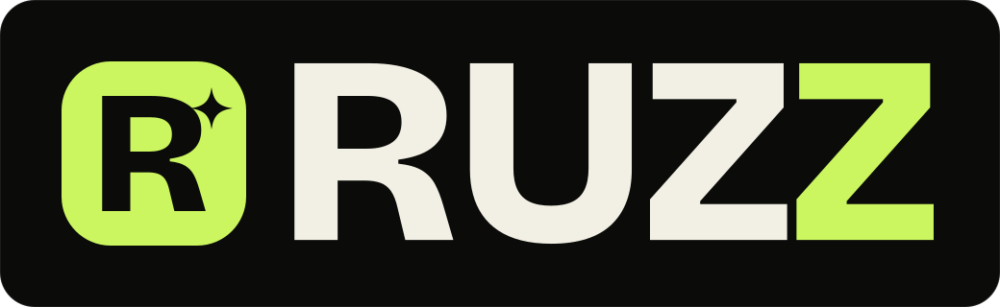

# Developer Portfolio

<p align="center">
  
</p>

A student developer portfolio for **Ruzz** — built with **React 19**, **Vite**, and **Tailwind CSS v4**. Warm editorial dark theme, expressive type, and a floating Waybar-inspired header. The projects are real: two thesis builds, a reservation platform, and a food ordering app.

## Featured projects

| Project | Stack | Link |
| --- | --- | --- |
| **FALCON-01** — IoT coastal monitoring buoy | Python, React, TypeScript, ESP32, SQLite | [Project-FALCON-01](https://github.com/Ruzz-1010/Project-FALCON-01) |
| **PuertoScanCare** — prescription-to-pharmacy decision support | Flutter, Dart, Material 3 | Private thesis repository |
| **Pickleball Reservation** — court bookings & PayMongo checkout | Laravel, PHP, PostgreSQL, Alpine.js | [Private-Sports-Court-Reservation-System](https://github.com/Ruzz-1010/Private-Sports-Court-Reservation-System) |
| **Food Ordering Platform** — multi-role ordering & live tracking | React, Express, MongoDB, Leaflet | [Live demo](https://food-ordering-app-one-mu.vercel.app) · [Source](https://github.com/Ruzz-1010/food-ordering-app) |

## Getting started

```bash
npm install
npm run dev
```

Open http://localhost:5173.

```bash
npm run build    # production build → dist/
npm run preview  # preview the production build
npm run lint     # oxlint
```

## Customize your content

Almost all content lives in a single file: **`src/data/portfolio.js`**.

| Export | What it controls |
| --- | --- |
| `profile` | Name, role, email, location, résumé URL, availability, socials |
| `navLinks` | Navbar + mobile menu links |
| `stats` | Hero stat strip |
| `techMarquee` | Scrolling technologies band |
| `skillGroups` | Stack cards |
| `additionalSkills` | Small chips below the stack |
| `projects` | Project cards (title, description, tags, links, screenshot, accent color, wide/featured layout) |
| `experience` | Timeline entries |
| `principles` | “How I work” rows in About |
| `quickFacts` | Quick facts card in About |

### Project visuals

Each card shows a real screenshot of the project's home page, stored in **`public/projects/`**:

- `falcon-01.webp` — live GitHub Pages presentation
- `puertoscancare.webp` — Flutter welcome screen
- `pickleball.webp` — Laravel reservation home page
- `food-ordering.webp` — React storefront home page

Point a project's `image` field at a new file to swap its artwork. Keep screenshots at **16:10** (for example 1440×900) so every card crops consistently.

### Résumé

Replace **`public/resume.pdf`** with an updated PDF (same filename), or change `profile.resumeUrl`. The current file is a one-page résumé generated from the real student projects on this site.

### Logo & brand assets

The custom **RUZZ** wordmark and **R** monogram live in **`src/components/Logo.jsx`**. They are vector paths, so they stay crisp at any size and match the oversized outlined wordmark in the footer.

Standalone assets in **`public/`**:

- `logo.svg` — full lockup on a dark card
- `logo-mark.svg` — R monogram tile
- `logo-wordmark.svg` — wordmark only, for dark backgrounds
- `favicon.svg` — browser icon

Swap the path constants in `Logo.jsx` and the SVGs in `public/` if you rebrand.

### Site metadata

Update the title, description, and Open Graph tags in **`index.html`**. The favicon is **`public/favicon.svg`**.

### Colors & type

Design tokens live in **`src/index.css`** under `@theme`:

```css
--color-surface: #0b0c0a;  /* ink graphite */
--color-surface-2: #111310;
--color-raised: #191c16;
--color-cream: #f2efe4;    /* warm bone */
--color-muted: #a4a499;    /* stone */
--color-accent: #cbf65f;   /* acid lime */
--color-accent-bright: #e3ff9c;
--color-butter: #e8e2cf;
--color-lilac: #a8b3a0;
--color-mint: #a6d9a8;

--font-display: 'Bricolage Grotesque', ...;
--font-sans: 'Geist', ...;
--font-serif: 'Instrument Serif', ...;
--font-mono: 'Geist Mono', ...;
```

Most components use the semantic tokens (`bg-accent`, `text-cream`, `text-muted`, `border-cream/10`), so changing the `--color-*` values rebrands the whole site. Project cards and experience entries have their own per-item `accent` values in `src/data/portfolio.js`. Fonts are loaded from Google Fonts in `index.html`.

### Motion & effects

Custom keyframes and utility classes live in `src/index.css`: scroll reveals (`.reveal`), aurora drift, marquee bands, spotlight cards, gradient text, rotating stamps, cursor glow, and grain. All non-essential animation is disabled under `prefers-reduced-motion`.

## Project structure

```
public/
  favicon.svg
  projects/            # project home-page screenshots (WebP, 16:10)
  resume.pdf
src/
  components/
    About.jsx          # bio + quick facts + principles
    BigMarquee.jsx     # lime availability marquee band
    Contact.jsx        # email CTA with copy-to-clipboard
    CountUp.jsx        # animated hero stats
    CursorGlow.jsx     # pointer-following ambient glow
    Experience.jsx     # work timeline + résumé CTA
    Footer.jsx
    Hero.jsx           # headline, CTAs, tilting code card, stats
    LocalTime.jsx      # live local clock
    Logo.jsx           # custom RUZZ wordmark + R monogram
    Navbar.jsx         # AI-companion header that expands into the Waybar-style nav
    ProjectVisual.jsx  # real project screenshot with crop + edge treatment
    Projects.jsx       # featured wide card, project grid, private repo handling
    Reveal.jsx         # IntersectionObserver scroll reveals
    RotatingStamp.jsx  # circular rotating text badge
    ScrollProgress.jsx
    SectionHeading.jsx
    Skills.jsx
    SocialLinks.jsx    # shared social icon links with brand hovers
    TechIcon.jsx       # brand-colored technology icons
    TechMarquee.jsx
    icons.jsx          # social SVG icons
  data/
    portfolio.js       # ← all site content
  utils/
    spotlight.js       # cursor-follow card glow
  App.jsx
  index.css            # Tailwind theme + custom effects
  main.jsx
```

## Deploy

### Vercel / Netlify

Import the repo, use the default Vite settings:

- Build command: `npm run build`
- Output directory: `dist`

### GitHub Pages

If the site is served from `https://<user>.github.io/<repo>/`, add the base path in `vite.config.js`:

```js
export default defineConfig({
  base: '/<repo>/',
  plugins: [react(), tailwindcss()],
})
```

## Accessibility & performance notes

- Semantic landmarks, a skip link, focus-visible rings, and labeled icon buttons.
- Scroll reveals, marquee, and pulse animations respect `prefers-reduced-motion`.
- No image assets for project art → tiny payload and crisp visuals at any resolution.
- Fonts are the only external request; everything else ships in the bundle.
